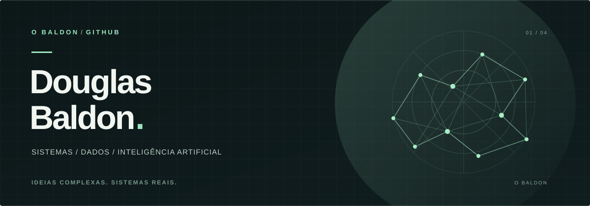

  

### Olá, eu sou Douglas.

Exploro a construção de sistemas que transformam dados e conhecimento em ferramentas úteis. Meu trabalho passa por **inteligência artificial, recuperação de informação, engenharia de software e automação** — da ingestão de documentos à experiência de quem usa o produto.

Gosto de entender o problema por inteiro: a origem dos dados, as decisões de arquitetura e os detalhes que tornam uma solução confiável no mundo real.

 

## Projetos em destaque

**01 &nbsp; [InteliReg RAG Service](https://github.com/oBaldon/rag-service)** 
Recuperação de informação regulatória com API, indexação e busca semântica. Uma peça de um ecossistema que conecta documentos a consultas contextualizadas. 
PYTHON · FASTAPI · POSTGRESQL · EMBEDDINGS

**02 &nbsp; [Bulário Service](https://github.com/oBaldon/bulario-service)** 
Pipeline para descoberta, ingestão, versionamento e extração de texto de bulas, com atenção à integridade e à rastreabilidade documental. 
PYTHON · PIPELINES DE DADOS · DOCUMENTOS · POSTGRESQL

**03 &nbsp; [YourVoice](https://github.com/oBaldon/yourvoice)** 
Experimento de comunicação por voz no navegador, com salas efêmeras e conexões diretas via WebRTC. O projeto está em desenvolvimento. 
TYPESCRIPT · WEBRTC · WEBSOCKETS · DOCKER

**04 &nbsp; [Audio Transcriber Service](https://github.com/oBaldon/audio-transcriber-service)** 
Serviço de transcrição de áudio com Whisper, alinhamento de palavras e identificação de locutores. 
PYTHON · FASTAPI · WHISPER · PROCESSAMENTO DE ÁUDIO

[Explorar todos os repositórios →](https://github.com/oBaldon?tab=repositories)

 

## Áreas de interesse

**Inteligência aplicada** &nbsp; / &nbsp; LLMs, busca semântica, RAG e processamento de linguagem 
**Engenharia de dados** &nbsp; / &nbsp; ingestão, pipelines, documentos e rastreabilidade 
**Construção de sistemas** &nbsp; / &nbsp; APIs, arquitetura, integração e automação 
**Experiências em tempo real** &nbsp; / &nbsp; voz, redes e comunicação entre navegadores

 

---

DOUGLAS BALDON &nbsp; / &nbsp; <a href="https://github.com/oBaldon">@OBALDON</a> &nbsp; / &nbsp; CONSTRUINDO, APRENDENDO E COMPARTILHANDO.
